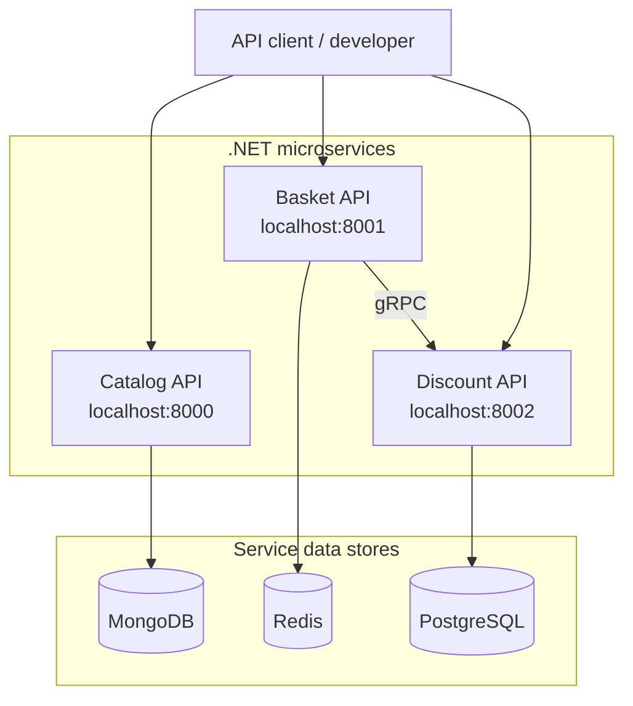

Ecommerce Microservices | .NET 10

A hands-on e-commerce backend project exploring microservices, Clean Architecture, and containerized local development with C# and .NET 10.

The solution currently contains three services—Catalog, Basket, and Discount—with separate application, core, infrastructure, and API projects. Docker Compose provides supporting databases and service-to-service connectivity.
Project status: This is an evolving learning/reference project, not a production-ready commerce platform. The README documents the components visible in the repository; additional features and production hardening are future work.

Contents
- Architecture
- Services
- Technology Stack
- Repository Structure
- Getting Started
- Local Service Addresses
- Configuration and Security
- Development
- Roadmap
- Contributing
- Maintainer
- License
Architecture
Each service is organized into API, Application, Core, and Infrastructure projects. The Docker Compose configuration defines the following local setup:

The diagram represents the local development topology defined in the Compose files. It is not a deployment or security architecture for production.

Clean Architecture organization
The solution groups projects into these layers:
Layer	Purpose
API	Hosts the service's HTTP/API entry point and configuration.
Application	Organizes application-level behavior and use cases.
Core	Represents the domain/core components.
Infrastructure	Integrates with supporting technical dependencies and persistence.

These are architectural responsibilities; see each service's code for its specific implementation.
Services
Service	Local API URL	Data store	Notes
Catalog	http://localhost:8000	MongoDB	Catalog service with separate API, Application, Core and Infrastructure projects.
Basket	http://localhost:8001	Redis	Basket service is configured to call the Discount service through gRPC.
Discount	http://localhost:8002	PostgreSQL 16	Discount service with its own database configuration.

Infrastructure exposed for local development: MongoDB 27017, Redis 6379, PostgreSQL 5432. Do not expose these database ports on an untrusted network.
Technology Stack
- Language and runtime: C#, .NET 10, ASP.NET Core
- Architecture: Microservices with Clean Architecture-style project separation
- Service communication: gRPC (Basket → Discount configuration)
- Data stores: MongoDB, Redis, PostgreSQL 16
- Containers: Docker and Docker Compose
- Solution: Ecommerce.sln
Repository Structure
Ecommerce/
├── Services/
│   ├── Catalog/
│   │   ├── Catalog.API/
│   │   ├── Catalog.Application/
│   │   ├── Catalog.Core/
│   │   └── Catalog.Infrastructure/
│   ├── Basket/
│   │   ├── Basket.API/
│   │   ├── Basket.Application/
│   │   ├── Basket.Core/
│   │   └── Basket.Infrastructure/
│   └── Discount/
│       ├── Discount.API/
│       ├── Discount.Application/
│       ├── Discount.Core/
│       └── Discount.Infrastructure/
├── Ecommerce.sln
├── docker-compose.yml
├── docker-compose.override.yml
├── docker-compose.dcproj
├── launchSettings.json
└── README.md
This is a high-level view of the projects included in Ecommerce.sln, not a listing of every source file.
Getting Started
Prerequisites
- Git
- Docker with Docker Compose v2
- Optional, for development outside containers: .NET 10 SDK
1. Clone the repository
git clone https://github.com/Rahul-Chaudhary583/Ecommerce.git
cd Ecommerce
2. Review development settings
Before starting the containers, inspect docker-compose.override.yml and configure database credentials appropriate only for local development. Replace the checked-in example password with a locally controlled value. Keep real secrets out of Git and never reuse development credentials in production.
3. Build and start the services
From the repository root:
docker compose up --build -d
Compose normally loads both docker-compose.yml and docker-compose.override.yml from the current directory.
4. Check containers and logs
docker compose ps
docker compose logs -f
The API ports configured for local development are listed below. Container startup and API behavior have not been independently tested as part of this README. If a service fails to start, inspect its logs and configuration.
5. Stop the services
docker compose down
The command above normally retains named database volumes. To delete local test data as well, run docker compose down -v only when you intend to remove those volumes.
Local Service Addresses
Component	Local address
Catalog API	http://localhost:8000
Basket API	http://localhost:8001
Discount API	http://localhost:8002
MongoDB	localhost:27017
Redis	localhost:6379
PostgreSQL	localhost:5432

These are published container ports, not guaranteed documentation, Swagger or health-check endpoints. Consult the API project code for the available routes.

Configuration and Security
The current Compose setup is intended for development, not production.
- docker-compose.yml declares the services, builds, and named volumes.
- docker-compose.override.yml configures local ports, environment variables, service dependencies, and development database settings.
- Important: The current public override file includes a hard-coded PostgreSQL password. Replace it with a locally supplied secret or environment variable, and rotate it if it has ever been used outside disposable local development.
- Do not commit real passwords, API keys, tokens, certificates, or customer information. Ensure secret values are excluded from version control.
- Restrict database ports and add authentication, HTTPS, secret management, monitoring, and security tests before any real deployment.
Development
To restore and build the solution locally with the .NET 10 SDK:
dotnet restore Ecommerce.sln
dotnet build Ecommerce.sln
For a single service, you can work from its Services/<ServiceName>/<ServiceName>.API/ project. Running a service outside Docker may require additional local database and environment configuration; check its appsettings and launch configuration before doing so.
Roadmap
The following items are planned improvements, not claims about features already delivered:
- [ ] Improve service-specific setup and API documentation
- [ ] Add automated unit and integration tests
- [ ] Add CI checks for restore, build and tests
- [ ] Remove hard-coded development credentials from tracked configuration
- [ ] Add structured logging, health checks and observability guidance
- [ ] Add clearer contributor documentation and sample requests
- [ ] Choose and add an explicit open-source license
Contributing
Feedback, bug reports, documentation corrections and code contributions are welcome.
1. Review open issues or open one to discuss your proposed change.
2. Fork the repository and create a branch from main.
3. Keep your change focused, and update documentation when behavior or setup changes.
4. Build and test the affected projects before submitting your work.
5. Open a pull request explaining what changed, why, and how it was tested.
Security reports: Avoid posting exploitable security issues or private credentials in public issues. Contact the maintainer privately using an appropriate channel.
Maintainer
Maintained by Rahul-Chaudhary583.
License
A license has not yet been specified. Public visibility alone does not grant permission to reuse or redistribute code. A LICENSE file should be added once the maintainer selects suitable terms.
